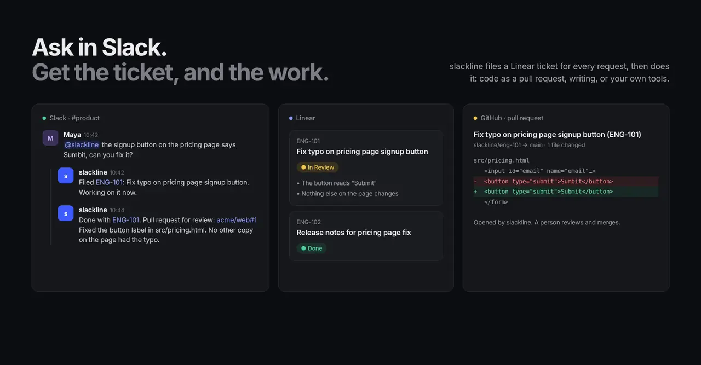

# slackline

**Ask in Slack. Get the ticket, and the work.**

slackline is a Slack agent for product teams. Mention it with a request and it files a proper Linear ticket, then does the work itself:

- **Code changes** become a pull request on GitHub. It never merges; a person reviews.
- **Writing** (copy, docs, specs, release notes) goes on the ticket and back to the thread.
- **Actions** use tools you define in a few lines of JavaScript, like posting an update or calling your own API.

If a request is too vague to act on, it asks one question instead of guessing.



## See it work in 10 seconds

No accounts or keys needed. This runs the real agent code, makes a real edit and a real git commit, with Slack, Linear, GitHub and Claude swapped for local stand-ins:

```bash
npx -y github:mrunaliyadavps/slackline demo
```

## How it works

```
Slack message ─► triage ─► Linear ticket ─► worker ─► ticket updated ─► reply in thread
                  │                          ├─ code:   clone, edit, test, commit, open PR
                  └─ too vague? ask once     ├─ write:  draft the text
                                             └─ action: call your tools
```

1. **Triage.** Claude reads the message and fills in a ticket: an imperative title, what was asked, and a "Done when" checklist. It also picks the kind of work. The agent checks the answer rather than trusting it: code work is only allowed in repos you list.
2. **Ticket.** The ticket is created in your Linear team and moved to In Progress. The thread gets the link straight away.
3. **Work.** Each kind of work has its own worker. The code worker gets file tools that can't reach outside the cloned repo or into `.git`, and edits must match exactly one place in a file. If you set a test command, it runs the tests before it finishes.
4. **Report.** The summary goes on the ticket and in the thread. Code tickets move to review with the PR link; writing and actions move to done. If anything fails, the ticket says so and stays with a person.

Requests run one at a time, so two jobs never fight over the same repo.

## Set it up

You need Node 20+, git, and admin access to a Slack workspace and a Linear team.

1. **Slack app.** Go to [api.slack.com/apps](https://api.slack.com/apps) → *Create New App* → *From a manifest*, and paste [`manifest.yml`](manifest.yml). Install it, copy the **Bot token** (`xoxb-…`), then under *Basic Information → App-Level Tokens* create one with `connections:write` (`xapp-…`). It uses Socket Mode, so there's no public URL to host.
2. **Linear.** Create a personal API key in Linear's settings. Put it in `.env` and run `doctor` (below); it lists your teams with their IDs so you can fill in `LINEAR_TEAM_ID`.
3. **Claude.** An API key from [console.anthropic.com](https://console.anthropic.com).
4. **GitHub (optional, for code work).** A fine-grained token with *Contents* and *Pull requests* write access to the repos in `SLACKLINE_REPOS`.

```bash
git clone https://github.com/mrunaliyadavps/slackline && cd slackline
npm ci
cp .env.example .env        # fill it in
node --env-file=.env bin/slackline.mjs doctor
node --env-file=.env bin/slackline.mjs run "write release notes for last week's fixes"
npm start                   # now mention @slackline in Slack
```

`.env.example` starts with `SLACKLINE_DRY_RUN=1`. In a dry run the agent files tickets and does the work, but it doesn't push code or call real actions. Turn it off when you trust it.

To run it somewhere permanent, use the [`Dockerfile`](Dockerfile): `docker run --env-file .env slackline`.

## Your own actions

Copy [`examples/slackline.config.mjs`](examples/slackline.config.mjs) to `slackline.config.mjs`. Each action is a name, a description the model reads, an input schema, and a `run()` function. You can also add team rules there, such as how titles should be written.

## Commands

| | |
|---|---|
| `slackline demo` | The offline demo above |
| `slackline doctor` | Checks each key and connection, and whether the GitHub token can push |
| `slackline run "…"` | Handles one request from the terminal, with replies printed instead of posted |
| `slackline start` | Connects to Slack |

## Safety, in plain terms

- It only acts on messages that mention it or DM it, and only from the users and channels you allow.
- It changes code only in repos you list, only on its own branch, and only through a pull request.
- File tools are confined to the cloned repo. `.git`, paths outside the repo and ambiguous edits are refused.
- Tool errors are handed back to the model to recover from, and there's a hard limit on steps (`SLACKLINE_MAX_TURNS`).
- It runs the test command you configure, so only set one you'd be happy to run on any branch.

## Status and honesty

This is an open-source rebuild of an internal agent I made that took Slack requests to Linear and completed them. The tests and the offline demo run in CI with stand-ins for Slack, Linear, GitHub and Claude. The adapters for the real services follow each SDK's documented API, but this repo hasn't been run against a live workspace by anyone but you yet. If something doesn't connect, `slackline doctor` will say which part, and issues are welcome.

## Develop

```bash
npm test        # 12 tests, no network
npm run demo
```

Code map: `src/agent.mjs` (the pipeline), `src/triage.mjs`, `src/workers.mjs`, `src/workspace.mjs` (sandboxed file tools), `src/llm.mjs` (tool loop and the scripted test model), `src/adapters/` (Slack, Linear, GitHub and their local stand-ins).

MIT © Mrunali Yadav
